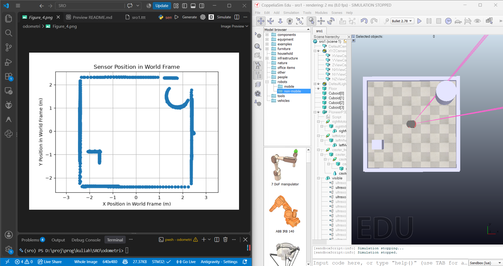
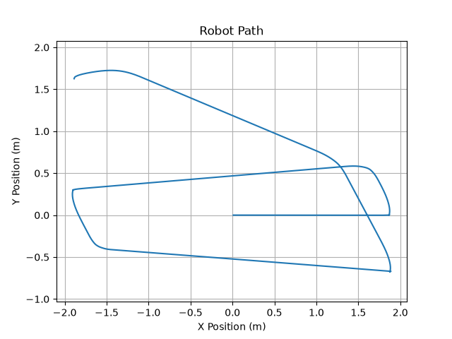
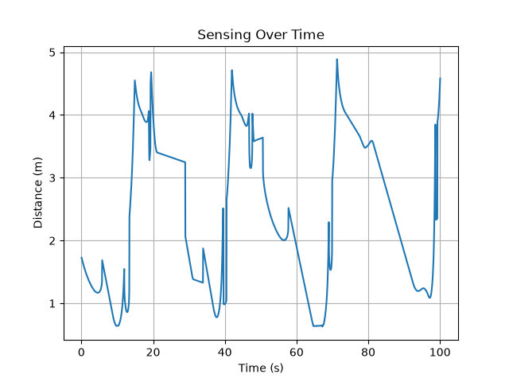
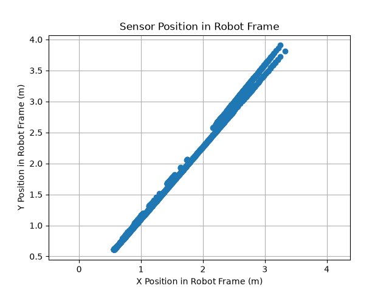
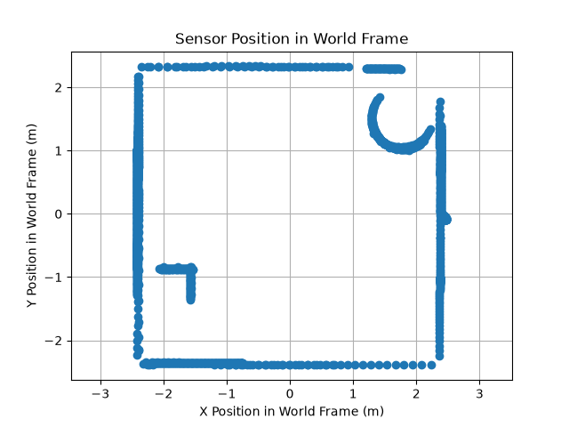

# Odometri dan Sensing Robot Pioneer P3DX

Eksperimen ini menggunakan **CoppeliaSim Edu** dan robot differential-drive
**Pioneer P3DX** untuk:




- menghitung posisi robot dari kecepatan kedua roda (odometri);
- membaca sensor proximity/ultrasonik;
- mentransformasikan titik hasil sensing dari frame sensor ke frame robot dan
  frame dunia; dan
- memvisualisasikan lintasan serta hasil sensing robot.

## Isi Folder

| File | Keterangan |
| --- | --- |
| `sro1.ttt` | Scene CoppeliaSim yang digunakan dalam simulasi. |
| `odometri.py` | Contoh odometri dasar dengan waktu nyata selama 20 detik. |
| `sensing_corrected.py` | Odometri dan transformasi sensor dengan stepping simulation selama 100 detik. |
| `copelia.png` | Tampilan scene robot dan sensor di CoppeliaSim. |
| `Figure_1.png` | Plot lintasan robot. |
| `Figure_2.png` | Plot jarak sensor terhadap waktu. |
| `Figure_3.png` | Titik deteksi pada frame robot. |
| `Figure_4.png` | Titik deteksi pada frame dunia. |

## Prasyarat

1. Install **CoppeliaSim Edu**.
2. Gunakan Python 3.10 atau yang lebih baru.
3. Install dependensi Python:

   ```bash
   python -m pip install numpy matplotlib coppeliasim-zmqremoteapi-client
   ```

4. Pastikan CoppeliaSim dapat diakses melalui **ZMQ Remote API**. Client Python
   akan terhubung ke server Remote API bawaan CoppeliaSim pada saat program
   dijalankan.

## Menjalankan Simulasi

1. Buka `sro1.ttt` dengan CoppeliaSim.
2. Pastikan model memiliki objek berikut:
   - `/PioneerP3DX`
   - `/PioneerP3DX/rightMotor`
   - `/PioneerP3DX/leftMotor`
   - sensor `/PioneerP3DX/ultrasonicSensor[1]` atau versi model yang berada
     di `/PioneerP3DX/visible/ultrasonicSensor[1]`
3. Jalankan simulasi dari CoppeliaSim.
4. Dari folder ini, jalankan salah satu script pada terminal:

   ```bash
   python odometri.py
   ```

   atau:

   ```bash
   python sensing_corrected.py
   ```

`odometri.py` menghentikan simulasi setelah sekitar 20 detik dan menampilkan
plot lintasan robot. `sensing_corrected.py` menggunakan simulation stepping,
menjalankan simulasi selama sekitar 100 detik, lalu menampilkan hingga empat
plot apabila sensor berhasil mendeteksi objek.

> Jalankan script hanya ketika scene dan koneksi Remote API siap. Tutup proses
> Python dengan benar agar blok `finally` dapat menghentikan simulasi secara
> aman.

## Ringkasan Perhitungan

Untuk robot differential-drive, script menggunakan:

```text
v = (wr + wl) * rw / 2
w = (wr - wl) * rw / (2 * rb)
```

Keterangan:

- `wr`, `wl`: kecepatan sudut roda kanan dan kiri;
- `rw`: radius roda, yaitu `0.195 / 2` meter;
- `rb`: setengah jarak antar roda, yaitu `0.381 / 2` meter.

Kecepatan linear kemudian diproyeksikan ke sumbu dunia berdasarkan orientasi
robot `theta`, lalu diintegrasikan terhadap `dt` untuk memperoleh posisi
odometri.

Pada `sensing_corrected.py`, titik yang dibaca sensor diproses dengan urutan:

```text
frame sensor -> frame robot -> frame dunia
```

Matriks rotasi dan translasi sensor diambil dari pose sensor terhadap robot.
`USE_SIM_POSE = True` menggunakan pose langsung dari CoppeliaSim. Jika
menggunakan nilai pose manual, ubah menjadi `False` dan sesuaikan nilai
orientasi serta posisi sensor dengan scene yang dipakai.

## Hasil

Contoh hasil yang diharapkan:

### Lintasan Robot



### Jarak Sensing terhadap Waktu



### Posisi Sensor pada Frame Robot



### Posisi Sensor pada Frame Dunia



Jika tidak ada objek yang terdeteksi, tiga plot sensing tidak dibuat dan
program menampilkan pesan `Sensor tidak mendeteksi apa pun selama simulasi.`

## Pemecahan Masalah

- **Gagal terhubung ke Remote API**: buka CoppeliaSim terlebih dahulu dan
  pastikan scene sedang aktif.
- **Objek tidak ditemukan**: periksa nama/path objek pada scene dan sesuaikan
  path pada script.
- **Sensor tidak menghasilkan data**: pastikan sensor mengarah ke objek,
  sensor aktif, dan indeks `SENSOR_IDX` sesuai dengan sensor pada scene.
- **Plot kosong atau berbeda**: hasil bergantung pada posisi awal robot,
  konfigurasi scene, arah sensor, dan gerakan robot saat simulasi.
